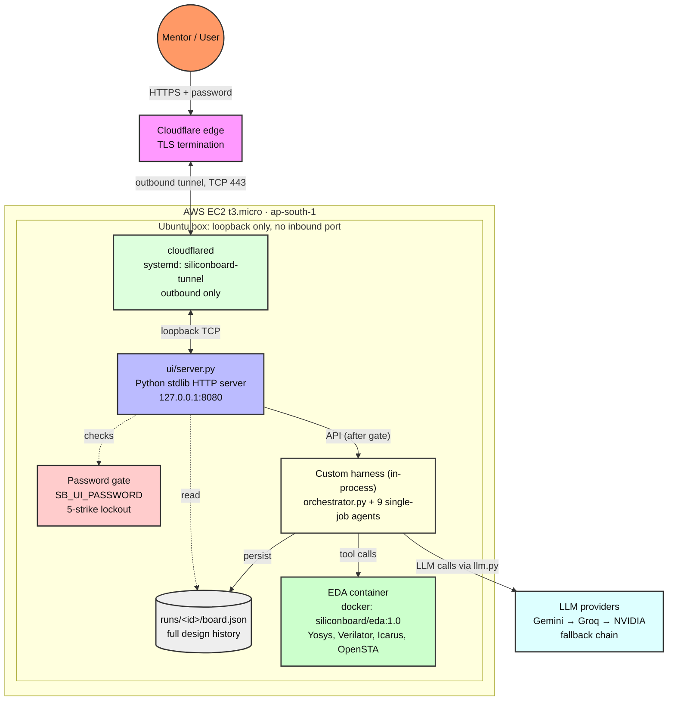
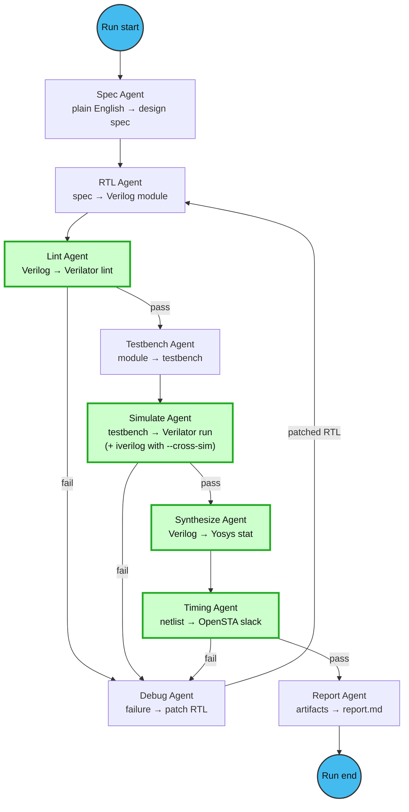
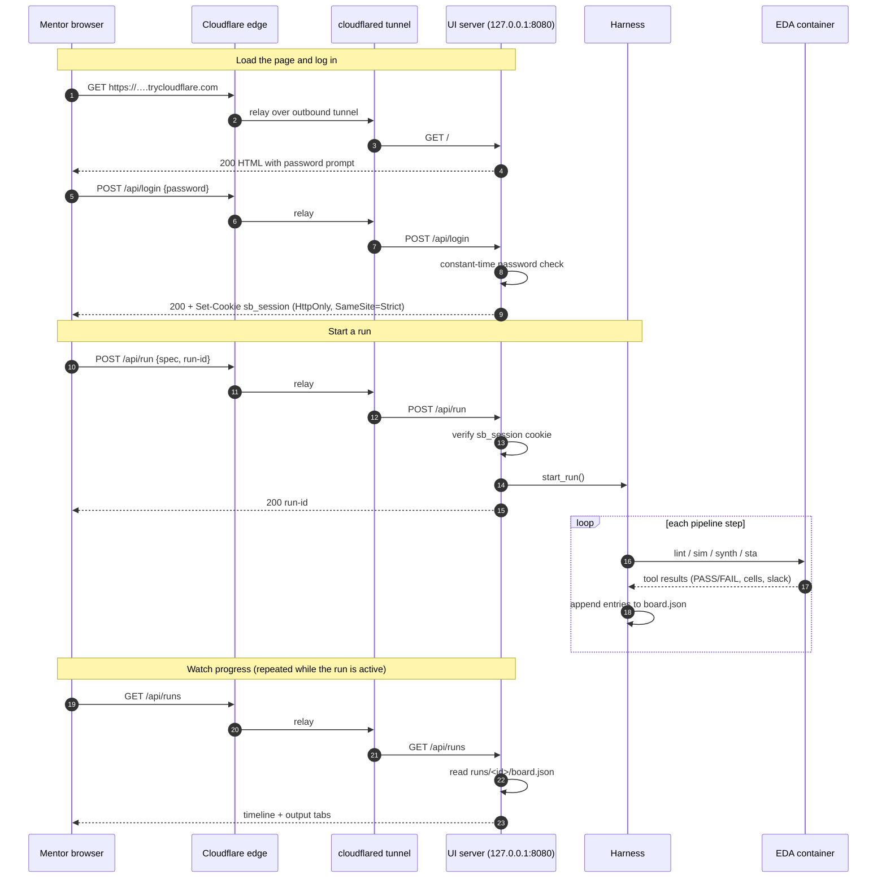
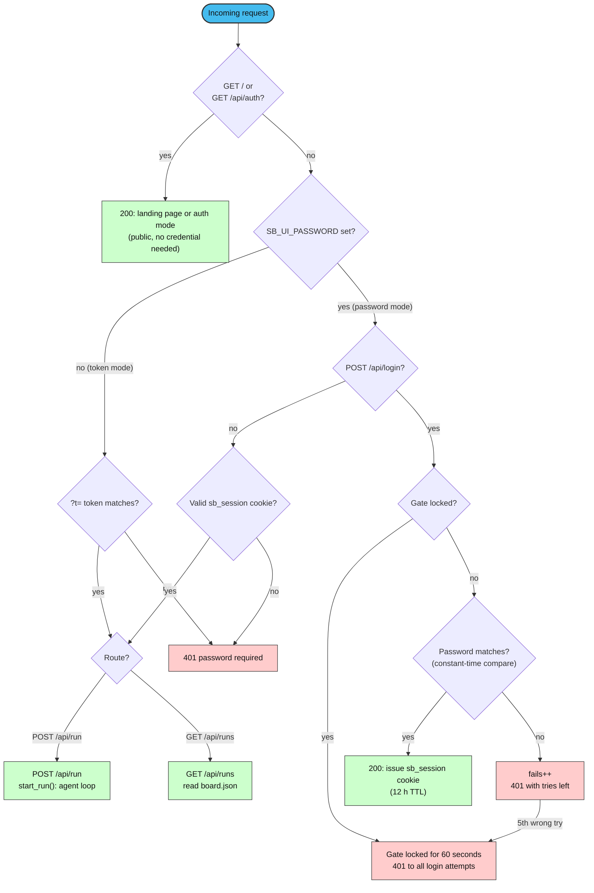

# siliconboard

Multi-agent chip design system. One shared Pydantic `Board` holds all design
state, a deterministic Python `Orchestrator` reads the Board's status and
dispatches single-job agents, and the agents that decide correctness (lint,
simulate, synthesize, timing) call real EDA tools with no LLM involved.

Rule the whole project is built around: **LLM agents propose, tools decide.**
`passed` comes from a Verilator log, `clean` from a Verilator exit code,
`cell_count` from a Yosys `stat`, `worst_slack_ns` from an OpenSTA parse. The model
never gets to report a test result. Gemini is the primary provider, but the
router falls back through Groq and NVIDIA, so a credit or rate-limit wall on one
provider doesn't stop a run.

No agent framework: no LangChain, no LangGraph, no CrewAI, no ADK. The loop,
the routing and the retry policy live in `orchestrator.py` and are ours.

## Contents

- [Quickstart](#quickstart)
- [Running a design](#running-a-design)
- [Checks](#checks)
- [Architecture](#architecture)
- [The agent loop](#the-agent-loop)
- [Seeing the design](#seeing-the-design)
- [Running the UI](#running-the-ui)
- [Request flow](#request-flow)
- [Auth gate](#auth-gate)
- [Live deployment](#live-deployment)
- [Repository layout](#repository-layout)
- [Conventions](#conventions)

## Quickstart

You need Python 3 and Docker.

```bash
python3 -m venv .venv && .venv/bin/pip install -r requirements.txt

docker build -t siliconboard/eda:1.0 docker/eda      # yosys + verilator + iverilog

cp .env.example .env && chmod 600 .env               # add GEMINI_API_KEY_1..4
.venv/bin/python main.py doctor                      # keys, docker, tool versions
```

## Running a design

```bash
.venv/bin/python main.py run --spec examples/fifo/spec.txt --run-id demo1 \
    --cross-sim --waves                      # two simulators, waveform dumped
.venv/bin/python main.py diff --run-id demo1 # what the debug loop changed
.venv/bin/python main.py replay --run-id demo1   # re-render the report, no LLM calls
.venv/bin/python main.py waves                  # which runs dumped a waveform, and how to open it
```

Every run leaves `runs/<id>/board.json`: the whole design history, one entry per
RTL version, simulation, bug report and tool log, so any claim the system makes
about its own work can be checked against what actually happened.

## Checks

```bash
.venv/bin/python tests/run_all.py          # board, parsers, Gemini schema canary
.venv/bin/python tests/check_toolchain.py  # real lint, real sim, real synthesis
```

`check_toolchain.py` is the trust anchor: until it is green, nothing the LLM
says matters. It lints a hand-written module, runs a real Verilator binary
simulation and asserts exactly one terminal `PASS`, then synthesizes and
asserts that a cell count parses.

## Architecture

The mentor's browser talks to Cloudflare over real HTTPS. Cloudflare relays the
connection through an **outbound** tunnel to `127.0.0.1:8080` on the EC2 box, so
the box opens no inbound port. The Python stdlib server checks the password gate
(`SB_UI_PASSWORD`) before any API call succeeds. Once authenticated, the
in-process harness runs the agents, which call the EDA toolchain inside a Docker
container and write every artifact to `runs/<id>/board.json`.



| Layer | Process | How it connects |
|---|---|---|
| **Edge** | Cloudflare edge | Terminates TLS, relays to the tunnel over TCP 443 |
| **Tunnel** | `cloudflared` (systemd: `siliconboard-tunnel`) | Dials outbound to Cloudflare, forwards to `127.0.0.1:8080` on loopback |
| **UI** | `ui/server.py` (systemd: `siliconboard-ui`) | Binds `127.0.0.1:8080` only, enforces the password gate on every API call |
| **Auth** | `SB_UI_PASSWORD` check | Constant-time compare, 5-strike lockout, `sb_session` cookie (HttpOnly, SameSite=Strict, 12 h TTL) |
| **Harness** | `orchestrator.py` (in-process) | Runs inside the same Python process as the UI; agents call LLM providers via `llm.py` |
| **LLM providers** | Gemini → Groq → NVIDIA | Gemini is primary; the chain takes over if it is rate-limited or out of credits |
| **EDA container** | `siliconboard/eda:1.0` | Yosys, Verilator, Icarus Verilog, OpenSTA. Tools decide, LLMs propose |
| **Storage** | `runs/<id>/board.json` | Full design history on disk, read by the UI for the timeline and output tabs |

## The agent loop

**The harness is custom code.** `orchestrator.py` implements the forward and
backward routing, the retry policy and Board persistence. Agents are single-job
files in `agents/`. Green nodes below are decided by a real tool, not by the
model. Failures route back through the Debug agent under the retry policy.



## Seeing the design

A run is four things you can open: the report, the board, a VCD waveform, and
the web UI (over an ssh tunnel or the public link).

### Web UI

The server (`ui/server.py`, stdlib only) binds **127.0.0.1:8080 and nothing
else**. Two credentials, never both at once:

- **no `SB_UI_PASSWORD`**: the shared token in the printed URL (local dev)
- **`SB_UI_PASSWORD` set**: only the password, via `POST /api/login`.
  Constant-time compare, five wrong tries lock the gate for a minute, and the
  token stops working entirely. The session is an `HttpOnly; SameSite=Strict`
  cookie; the password never appears in a URL or in storage.

What it gives you:

- **live workflow**: which agent is working right now, how long each agent
  took, what it produced (module, ports, checks, cells, slack), streamed from
  `board.json` as the run writes it
- **first-use instructions** on the page, suggested specs you can click, and a
  golden run you can browse before spending a cent on tokens
- **output in multiple formats**: report.md, board.json, syntax-highlighted
  Verilog, ASCII waveform, tool logs, all read from the run's own artifacts
- **history**: every run paired with the input that produced it

Keys never reach the browser.

### Terminal

A run is also three files you can open without any UI: the report, the board,
and (with `--waves`) a VCD waveform.

```bash
.venv/bin/python main.py run --spec examples/counter/spec.txt --run-id w1 --waves
.venv/bin/python main.py waves                      # every run that dumped one
.venv/bin/python main.py waves --run-id w1          # signals, widths, time span
.venv/bin/python main.py waves --run-id w1 --draw   # draw it here, no viewer needed
.venv/bin/python main.py waves --run-id w1 --open   # launch a GUI viewer, if one is installed
```

`--draw` is the default answer: it parses the VCD itself and prints a timing
diagram in the terminal, so nothing has to be installed. Buses also get their
value sequence printed underneath, so `count` reads as `0 1 2 … 255` rather
than a smear of overlapping labels.

If you want a real GUI viewer on macOS, `brew install surfer` works (it is a
formula, not a cask; the project lives at
[gitlab.com/surfer-project/surfer](https://gitlab.com/surfer-project/surfer)).
The `gtkwave` cask is disabled in Homebrew. `--open` uses `surfer`, `gtkwave` or
`vcd2fst` if any is present.

`--draw` is behaviour over time, not a schematic. For an 8-bit counter a
picture of 28 cells would tell you less than `main.py diff` does.

## Running the UI

Pick one of four modes. All of them keep the server on loopback.

**1. Local, token mode** (no password, local dev only)

```bash
.venv/bin/python ui/server.py --port 8080
# prints: http://127.0.0.1:8080/?t=<token>
# Share that exact URL: the token is the credential
```

**2. Local, password mode**

```bash
SB_UI_PASSWORD='your-password' .venv/bin/python ui/server.py --port 8080
```

**3. Remote box over an SSH tunnel** (the server already runs there as `siliconboard-ui`)

```bash
bash ui/tunnel.sh              # from your laptop: ssh tunnel, prints the local url
bash ui/tunnel.sh --phone      # also reachable from a phone/tablet on your Wi-Fi
```

**4. Public link via a Cloudflare quick tunnel** (no open ports)

```bash
UI_PASSWORD='your-password' bash deploy/deploy.sh
# Pass 1: sets SB_UI_PASSWORD in /etc/siliconboard/env, installs services
# Pass 2: re-deploys without recreating the box (SKIP_STA=1)
# Prints: https://….trycloudflare.com
```

`deploy/deploy.sh` installs and health-checks the `siliconboard-ui` unit
(loopback only) plus the `siliconboard-tunnel` unit, both with `Restart=always`.
The box still listens on **127.0.0.1 only**: no inbound port, no security-group
rule (still just `tcp/22` from your IP), TLS terminated at the edge. The
password is the whole security boundary: anyone with the URL but not the
password gets `401`. Run it again with a new `UI_PASSWORD` to rotate it.

## Request flow

One login, one run, one poll, end to end. Every request enters through
Cloudflare and the tunnel; responses travel back the same way.



## Auth gate

How the server decides what to do with a request. The landing page and the
`/api/auth` probe are public so the page can show a password prompt; everything
else needs a credential.



## Live deployment

Snapshot of the published instance.

| Item | Value |
|---|---|
| **Instance** | EC2 t3.micro, `ap-south-1` |
| **Public URL** | `https://experiencing-occupied-sea-footage.trycloudflare.com` |
| **Password** | Shared privately. Never commit it; set it with `UI_PASSWORD` when deploying |
| **TLS** | Real certificate (Google Trust Services), terminated at Cloudflare's edge |
| **Box listener** | `127.0.0.1:8080` only (loopback) |
| **Security group** | `tcp/22` from your IP only, **no inbound port opened** |
| **UI systemd unit** | `siliconboard-ui`: `active`, `enabled` |
| **Tunnel systemd unit** | `siliconboard-tunnel`: `active`, `enabled`, `Restart=always` |
| **Sessions** | In-memory, 12-hour TTL, `HttpOnly; SameSite=Strict` cookie |

> **Heads up:** a Cloudflare quick-tunnel URL is random and changes whenever
> `cloudflared` starts fresh, so the URL above goes stale after a redeploy or a
> restart. `deploy/deploy.sh` prints the current one.

The password gate is enforced on every API call. Wrong passwords increment a
strike counter, and five strikes lock the gate for 60 seconds (see
[Auth gate](#auth-gate)).

## Repository layout

| Path | What lives there |
|---|---|
| `board.py` | `Board`, `DesignStatus`, every artifact and report model |
| `tools.py` | the one docker wrapper plus every parser that decides a fact |
| `agent.py` | one agent shape, prompt builder, log trimmer |
| `llm.py` | the whole LLM integration: one function, model fallback chains, key rings, per-run cache |
| `orchestrator.py` | forward/backward routing, retry policy, Board persistence |
| `agents/` | one file per agent, one job per file |
| `smoke/` | hand-written RTL + TB that prove the toolchain, no LLM involved |
| `tests/` | assert-based checks, no test framework |
| `evidence/` | raw output of each verified task |
| `demo/` | the 5-minute script and the golden run snapshots it replays |
| `deploy/` | one-command laptop deploy (`deploy.sh`), server bootstrap, systemd unit, compose file |
| `ui/` | web UI: per-agent timeline renderer, stdlib HTTP server, one static page, ssh tunnel helper |
| `TASKS.md` | the ledger: every task, its verify command, its evidence file |


## Conventions

Two dependencies, `google-genai` and `pydantic`. Stdlib and the container do
the rest.